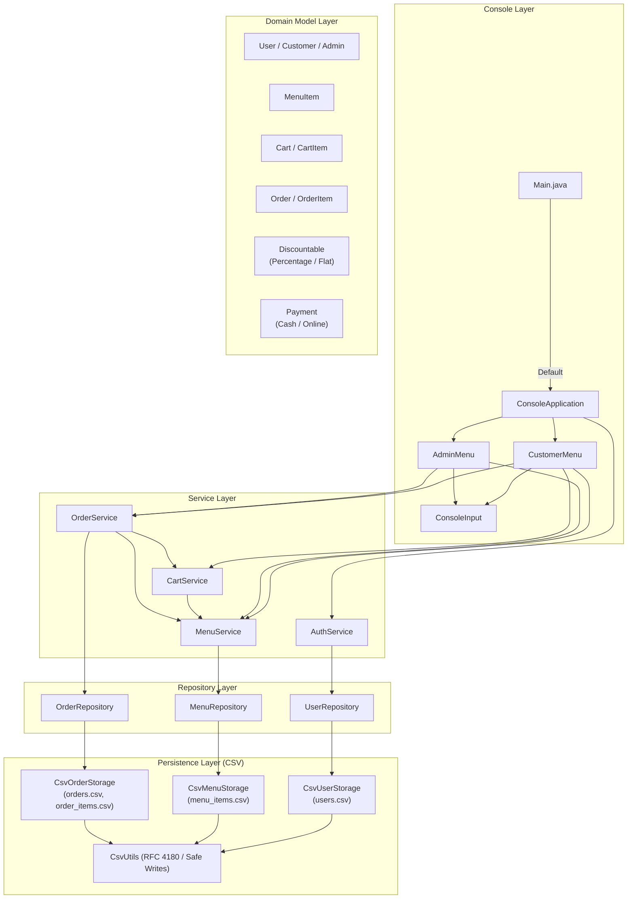

# Food Ordering System (Java 21 Console Application)

A robust, modular, console-driven food ordering and restaurant management application built with **Java 21**, **Maven**, **JUnit 5**, **RFC 4180 CSV Persistence**, and **Docker**.

Developed as an Object-Oriented Programming (OOP) demonstration project, this system models the end-to-end lifecycle of a restaurant ordering platform: secure multi-role authentication (Customer & Administrator), interactive menu management, dynamic shopping cart accumulation, discount strategies, simulated polymorphic payments, historical order snapshots, and atomic file-based persistence.

---

## Table of Contents

1. [Project Overview](#project-overview)
2. [Implemented Features](#implemented-features)
3. [Technology Stack](#technology-stack)
4. [OOP Concepts Demonstrated](#oop-concepts-demonstrated)
5. [System Architecture](#system-architecture)
6. [Setup & Execution Guide](#setup--execution-guide)
7. [Data Architecture & Security](#data-architecture--security)
8. [Known Limitations & Future Enhancements](#known-limitations--future-enhancements)

---

## 1. Project Overview

The Java Food Ordering System provides a production-grade console experience with strict role separation:
- **Customers** register accounts, authenticate securely, browse active menus, search and filter food items, assemble orders in a shopping cart, apply discounts, select payment options, receive immutable purchase receipts, and track their orders.
- **Administrators** control catalog items (adding, updating price/name/category, toggling customer availability, removing), replenish inventory stock, inspect all customer orders, and transition orders through their operational lifecycle (`CONFIRMED` $\to$ `PREPARING` $\to$ `READY` $\to$ `DELIVERED` or `CANCELLED`).
- **Data Persistence** is achieved through custom RFC 4180-compliant CSV storage with atomic replacement semantics and in-memory rollback capabilities, retaining all records across application restarts without relying on third-party database engines.

---

## 2. Implemented Features

### 2.1 Customer Dashboard
- **Menu Catalog Browsing**: View available dishes with live unit prices and remaining stock.
- **Search & Filtering**: Search dishes by keyword (case-insensitive) or filter by category (e.g. Pizza, Burgers, Salads).
- **Shopping Cart Management**: Add items with requested quantities; automatic quantity merging for duplicate selections; in-place quantity updates; line removal; complete cart clearing.
- **Stock Guard Invariants**: Real-time validation preventing orders from exceeding in-stock quantities or purchasing hidden items.
- **Dynamic Discounts**: Support for Percentage Discounts (0–100%) and Flat Amount Deductions (capped at subtotal to prevent negative totals).
- **Payment Processing**: Choice between Cash on Delivery (COD) and Simulated Online Gateway Payment (Card/UPI) with configurable approval/decline simulations.
- **Order Placement & Receipting**: Generates immutable `OrderItem` snapshots preserving purchase-time names and prices; prints itemized receipts with unique order IDs and transaction references.
- **Order History & Secure Tracking**: Customer order history listing; strict ownership validation ensuring customers can only track their own orders.

### 2.2 Administrator Dashboard
- **Menu Item Authoring**: Add new menu items with customized IDs, categories, prices, stock quantities, and visibility flags.
- **Inventory Replenishment**: Direct restock operation enforcing positive additions.
- **Item Attribute Modification**: Edit item names, categories, and unit prices dynamically.
- **Catalog Visibility Control**: Toggle item availability to immediately hide seasonal or sold-out items from customers.
- **Item Removal**: Permanently remove items from the catalog.
- **Global Order Monitoring**: View all placed orders across all customers in a formatted tabular overview.
- **Order Detail Inspection**: Query any order by ID to view line item snapshots, financial totals, and transaction metadata.
- **Lifecycle Status Management**: Advance orders through valid business transitions:
  - `PENDING` $\to$ `CONFIRMED` or `CANCELLED`
  - `CONFIRMED` $\to$ `PREPARING` or `CANCELLED`
  - `PREPARING` $\to$ `READY` or `CANCELLED`
  - `READY` $\to$ `DELIVERED` or `CANCELLED`
  - `DELIVERED` & `CANCELLED` are terminal states; no further transitions are permitted.

---

## 3. Technology Stack

- **Language**: Java 21 LTS (utilizing Pattern Matching, Switch Expressions, Text Blocks, Records/Immutability idioms).
- **Build & Dependency Management**: Apache Maven 3.9+.
- **Testing Framework**: JUnit 5 (Jupiter 5.10.2) with nested test classes and `@TempDir` file isolation.
- **Persistence Mechanism**: Custom RFC 4180 CSV serializer/deserializer with UTF-8 character encoding and atomic filesystem operations.
- **Containerization**: Docker (multi-stage build with Eclipse Temurin 21 JRE Alpine) and Docker Compose.

---

## 4. OOP Concepts Demonstrated

The codebase is specifically designed to showcase core Object-Oriented Programming principles:

### 4.1 Encapsulation
- **Private State & Guarded Mutators**: Domain models such as [`MenuItem`](file:///mnt/ai/Projects/Food_order_java/food-ordering-system/src/main/java/com/foodordering/model/MenuItem.java), [`Cart`](file:///mnt/ai/Projects/Food_order_java/food-ordering-system/src/main/java/com/foodordering/model/Cart.java), and [`Order`](file:///mnt/ai/Projects/Food_order_java/food-ordering-system/src/main/java/com/foodordering/model/Order.java) declare private fields.
- **Unmodifiable Collection Exposure**: Getters return unmodifiable views (e.g. `Collections.unmodifiableList(...)` in `Order.getItems()` and `Collections.unmodifiableMap(...)` in `Cart.getItems()`), preventing external modification of internal collections.
- **Defensive Immutability**: [`OrderItem`](file:///mnt/ai/Projects/Food_order_java/food-ordering-system/src/main/java/com/foodordering/model/OrderItem.java) declares all fields as `private final`, capturing purchase-time historical price and name snapshots without referencing live mutable objects.

### 4.2 Abstraction
- **Abstract Base Classes**:
  - [`User`](file:///mnt/ai/Projects/Food_order_java/food-ordering-system/src/main/java/com/foodordering/model/User.java): Captures shared identity fields (`userId`, `name`, `email`, `passwordHash`) and declares the abstract method `public abstract String getRole()`.
  - [`Payment`](file:///mnt/ai/Projects/Food_order_java/food-ordering-system/src/main/java/com/foodordering/payment/Payment.java): Encapsulates monetary amount validation and lifecycle status (`PaymentStatus`), declaring the abstract contract `public abstract PaymentStatus processPayment()`.

### 4.3 Inheritance
- **Model Hierarchies**:
  - `Customer extends User`: Inherits identity attributes and adds `deliveryAddress`.
  - `Admin extends User`: Inherits identity attributes and adds `adminCode`.
  - `CashPayment extends Payment`: Specializes payment behavior for cash transactions.
  - `OnlinePayment extends Payment`: Specializes payment behavior for digital gateway simulations with unique transaction reference generation.

### 4.4 Interfaces & Polymorphism
- **Strategy Pattern via Interface**:
  - [`Discountable`](file:///mnt/ai/Projects/Food_order_java/food-ordering-system/src/main/java/com/foodordering/discount/Discountable.java) defines `BigDecimal applyDiscount(BigDecimal amount)`.
  - Concrete strategies: [`PercentageDiscount`](file:///mnt/ai/Projects/Food_order_java/food-ordering-system/src/main/java/com/foodordering/discount/PercentageDiscount.java) and [`FlatDiscount`](file:///mnt/ai/Projects/Food_order_java/food-ordering-system/src/main/java/com/foodordering/discount/FlatDiscount.java).
- **Runtime Polymorphism**:
  - `OrderService.placeOrder` accepts any `Discountable` implementation and any `Payment` subclass. At checkout, `payment.processPayment()` executes the appropriate concrete logic dynamically.
- **Compile-Time Polymorphism (Method Overloading)**:
  - `OrderService.placeOrder(Customer, Cart, Discountable, Payment)` and `OrderService.placeOrder(Customer, Cart, Discountable, Function<BigDecimal, Payment>)`.
  - `PercentageDiscount(BigDecimal)`, `PercentageDiscount(int)`, and `PercentageDiscount(String)`.
  - `CashPayment(BigDecimal)` and `CashPayment(String)`.

### 4.5 Composition
- **Object Relationships**:
  - A `Cart` is composed of multiple `CartItem` instances.
  - An `Order` is composed of multiple immutable `OrderItem` snapshots.
  - `OrderService` delegates to `OrderRepository`, `MenuService`, and `CartService`.

### 4.6 Exception Handling & Fault Tolerance
- **Domain Exception Hierarchy**: Custom runtime exceptions (`InvalidInputException`, `DuplicateItemException`, `ItemNotFoundException`, `InsufficientStockException`, `OrderNotFoundException`, `PaymentFailedException`, `AuthenticationException`, `PersistenceException`) translate low-level errors into clear business semantics.
- **Compensatory Rollback**:
  - If saving an order fails after inventory deduction, `OrderService` executes compensatory restocking via `rollbackInventory(...)`.
  - If writing to CSV fails, `MenuRepository`, `OrderRepository`, and `UserRepository` revert in-memory map modifications.

---

## 5. System Architecture



---

## 6. Setup & Execution Guide

### 6.1 Prerequisites
- **Java Development Kit (JDK) 21** or higher.
- **Apache Maven 3.9+** installed and available in `PATH`.
- *(Optional)* **Docker** and **Docker Compose** for containerized execution.

### 6.2 Build and Test Commands
To compile the codebase and run all automated unit and integration tests:
```bash
# Clean, compile, and execute all tests
mvn clean test

# Build executable JAR without tests
mvn clean package -DskipTests

# Build executable JAR with tests
mvn clean package
```

### 6.3 Running the Application

#### Option A: Run via Maven Exec
```bash
mvn compile exec:java -Dexec.mainClass="com.foodordering.Main"
```

#### Option B: Run Packaged Executable JAR
```bash
java -jar target/food-ordering-system.jar
```

#### Option C: Run Automated Demonstration Mode
To execute the automated non-interactive demonstration of Parts 2 through 6:
```bash
java -jar target/food-ordering-system.jar --demo
# or via JVM property
java -Dfoodordering.demo=true -jar target/food-ordering-system.jar
```

#### Option D: Launch via Docker Compose

> [!IMPORTANT]
> **Do not use `docker compose up`** to run this interactive console application. `docker compose up` runs services in background logging mode without attaching your terminal's keyboard input (`stdin`), causing the console prompts (such as the First-Run Provisioning Wizard) to appear stuck because you cannot type answers. Always use `docker compose run` as shown below.

##### 1. Interactive Bash Session (Recommended if you want shell access):
To enter the container's `bash` shell with an interactive terminal:
```bash
docker compose run --rm food-ordering-system bash
```
Once inside `bash`, start the application with either command:
```bash
java -jar app.jar
# or
./run.sh
```
Now your keyboard input is attached directly, allowing you to answer all prompts seamlessly.

##### 2. Direct Interactive Launch:
To start the console UI immediately with full interactive input:
```bash
docker compose run --rm food-ordering-system
```

### 6.4 First-Run Administrator Provisioning
On the first startup with an empty data directory, the application detects that no administrator account exists. It initiates the **Interactive Administrator Provisioning Wizard**:
```text
********************************************************
       FIRST-RUN ADMINISTRATOR PROVISIONING WIZARD       
  No existing administrator was detected in storage.   
  Please provision the initial system administrator.    
********************************************************
  Choose Administrator ID (no spaces): sysadmin
  Enter Full Display Name: System Lead
  Enter Email Address: lead@foodordering.com
  Enter Strong Password (min 8 chars): MasterAdmin@2026
  Confirm Password: MasterAdmin@2026
  Enter Administrator Security Code (min 4 chars): SEC-9988
  Confirm Security Code: SEC-9988
```
*(Alternatively, for automated deployments, administrators can be provisioned via environment variables `FOOD_ORDERING_ADMIN_ID`, `FOOD_ORDERING_ADMIN_NAME`, `FOOD_ORDERING_ADMIN_EMAIL`, `FOOD_ORDERING_ADMIN_PASSWORD`, and `FOOD_ORDERING_ADMIN_CODE`.)*

### 6.5 Configuring the Data Directory
Storage directory precedence:
1. Java System Property: `-Dfoodordering.data.dir=/custom/path`
2. Environment Variable: `export FOOD_ORDERING_DATA_DIR=/custom/path`
3. Default Working Directory: `./data`

---

## 7. Data Architecture & Security

### 7.1 CSV File Schemas

#### 1. `users.csv`
```csv
user_id,role,name,email,password_hash,delivery_address,admin_code
```
- `role`: `CUSTOMER` or `ADMIN`.
- For `CUSTOMER`: `delivery_address` is stored; `admin_code` is left blank.
- For `ADMIN`: `delivery_address` is blank; `admin_code` is stored.

#### 2. `menu_items.csv`
```csv
id,name,category,price,stock_quantity,available
```

#### 3. `orders.csv`
```csv
order_id,customer_id,status,payment_status,subtotal,discount_amount,final_total,created_at,transaction_reference
```

#### 4. `order_items.csv`
```csv
order_id,menu_item_id,item_name,unit_price,quantity,subtotal
```

### 7.2 Cryptographic Password Storage
- Passwords are hashed using **PBKDF2 with HMAC-SHA256** (`PBKDF2WithHmacSHA256`).
- **Iteration Count**: 65,536 iterations (aligning with OWASP security recommendations).
- **Salt Generation**: 128-bit (16-byte) independent cryptographically secure random salt generated via `java.security.SecureRandom`.
- **Derived Key Length**: 256 bits (32 bytes).
- **Storage Format**: `PBKDF2WithHmacSHA256:<iterations>:<saltHex>:<derivedHashHex>`.
- **Constant-Time Verification**: Verification utilizes `MessageDigest.isEqual(...)` to eliminate timing side-channel attacks.

### 7.3 Fault-Tolerant Atomic Persistence
- All CSV write operations write to a temporary file in the target directory (`<target>.tmp`) using UTF-8 encoding.
- Streams are flushed and closed before performing an atomic file move (`StandardCopyOption.ATOMIC_MOVE` with fallback to `REPLACE_EXISTING`).
- If an I/O error occurs, the temporary file is deleted, preserving the original valid data file.

---

## 8. Known Limitations & Future Enhancements

| Area | Current Implementation Status | Future Enhancement Scope |
|---|---|---|
| **Payment Gateway** | Simulated in-memory polymorphic abstraction with deterministic success/decline outcomes. | Integration with real PCI-DSS compliant payment gateways (Stripe, PayPal, Razorpay). |
| **Transaction Atomicity** | Application-level compensatory rollback (inventory replenishment on persistence failure). | Two-phase commit (2PC) or relational ACID RDBMS transaction management. |
| **Data Persistence** | RFC 4180 file-based CSV persistence with atomic file replacement. | Relational database persistence (PostgreSQL / MySQL) via JPA / Hibernate. |
| **User Interface** | ANSI-formatted interactive console menu driven by safe scanner input. | Modern responsive Web SPA (React / Angular) backed by Spring Boot REST APIs. |
| **Order Cancellation** | State transition validation (cancellation permitted prior to `DELIVERED`); inventory and funds are not automatically refunded. | Automated refund processing and configurable automated inventory return policies. |
