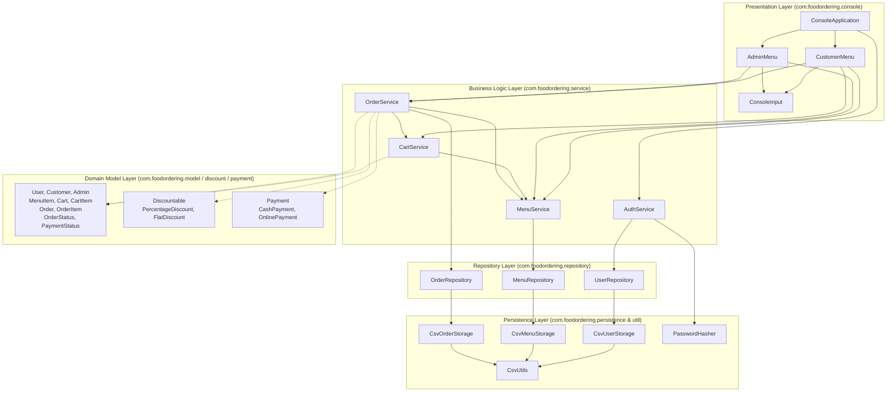
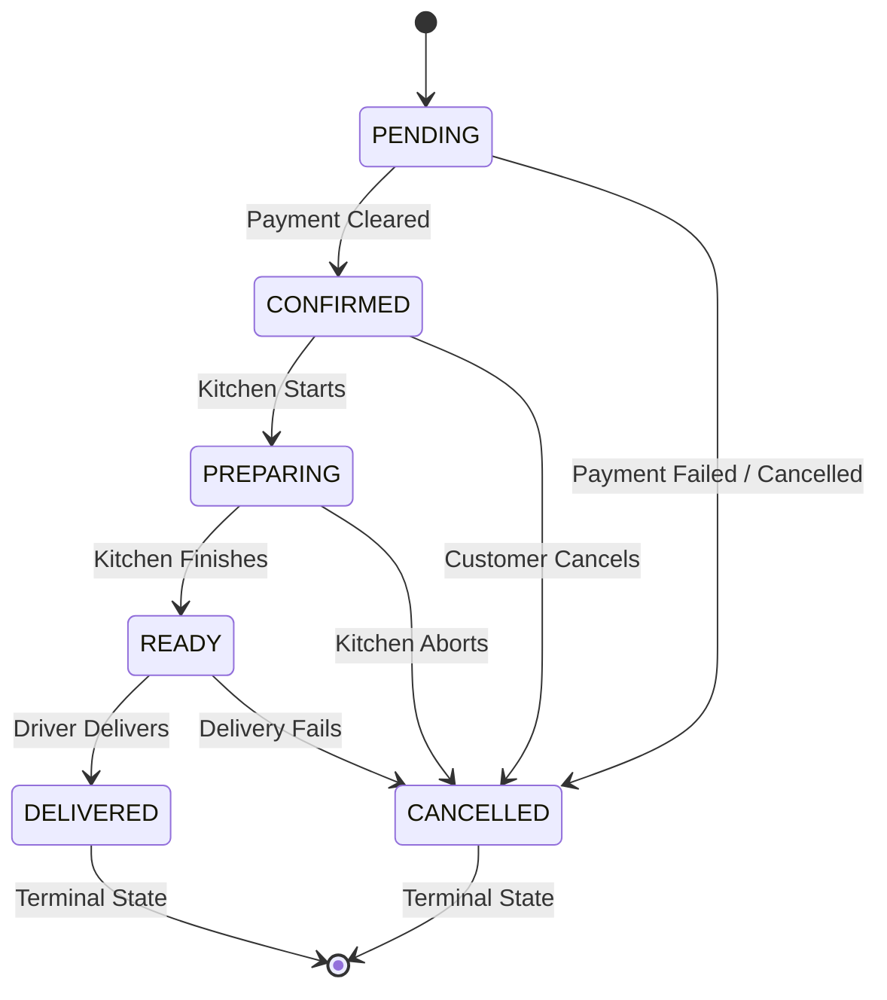

# Object-Oriented Programming (OOP) Viva & Technical Exam Notes
## Java 21 Food Ordering System — Comprehensive Project Study Guide

> **Target Audience:** B.Tech Computer Science & Engineering (CSE) Students  
> **Course Subject:** Object-Oriented Programming (Java) / Software Engineering Laboratory  
> **Repository:** `food-ordering-system` (Java 21 LTS, Apache Maven, JUnit 5, Docker)  
> **Author/Maintainer Reference:** Academic Demonstration Project  

---

## Table of Contents

1. [Section One — Project Overview](#section-one--project-overview)
2. [Section Two — Project Architecture & Layered Design](#section-two--project-architecture--layered-design)
3. [Section Three — The Four Pillars of OOP in Action](#section-three--the-four-pillars-of-oop-in-action)
   - [3.1 Encapsulation](#31-encapsulation)
   - [3.2 Abstraction](#32-abstraction)
   - [3.3 Inheritance](#33-inheritance)
   - [3.4 Polymorphism (Compile-Time & Runtime)](#34-polymorphism-compile-time--runtime)
4. [Section Four — Every Important Class Explained](#section-four--every-important-class-explained)
5. [Section Five — Java Language Fundamentals Demonstrated](#section-five--java-language-fundamentals-demonstrated)
6. [Section Six — SOLID Principles and Design Patterns](#section-six--solid-principles-and-design-patterns)
7. [Section Seven — Money, Discounts, and Payments](#section-seven--money-discounts-and-payments)
8. [Section Eight — Cart, Orders, and Object Relationships](#section-eight--cart-orders-and-object-relationships)
9. [Section Nine — File Handling and CSV Persistence](#section-nine--file-handling-and-csv-persistence)
10. [Section Ten — Authentication and Cryptographic Security](#section-ten--authentication-and-cryptographic-security)
11. [Section Eleven — Docker and Container Build Pipeline](#section-eleven--docker-and-container-build-pipeline)
12. [Section Twelve — Complete End-to-End Execution Traces](#section-twelve--complete-end-to-end-execution-traces)
13. [Section Thirteen — Testing, Assertions, and Debugging](#section-thirteen--testing-assertions-and-debugging)
14. [Section Fourteen — Comprehensive Viva Questions & Model Answers](#section-fourteen--comprehensive-viva-questions--model-answers)
    - [Level 1: Beginner Fundamentals](#level-1-beginner-fundamentals-q1--q15)
    - [Level 2: Project-Specific Architecture](#level-2-project-specific-architecture-q16--q32)
    - [Level 3: Follow-Up & Deep Dive](#level-3-follow-up--deep-dive-q33--q48)
    - [Level 4: Challenging Edge Cases & Tradeoffs](#level-4-challenging-edge-cases--tradeoffs-q49--q65)
15. [Section Fifteen — Rapid Revision Cheat Sheet](#section-fifteen--rapid-revision-cheat-sheet)

---

# Section One — Project Overview

### 1.1 What Problem Does This Application Solve?
In real-world food service operations, restaurants must handle catalog management, inventory tracking, customer ordering, discount calculations, secure credential storage, and payment processing while keeping historical audit records completely safe from future menu price changes. 

Many student projects make critical design mistakes:
1. They use floating-point types (`float` or `double`) for money, causing binary representation errors.
2. They store direct references to live `MenuItem` objects in completed orders; when the restaurant updates a pizza price next week, past receipts silently change their totals!
3. They mix user input, SQL or file access, and validation rules in a single giant `Main.java` file.

This **Java Food Ordering System** solves these problems cleanly. It is an enterprise-grade, console-driven food ordering and restaurant management platform written in modern **Java 21 LTS**. It models the complete lifecycle of food ordering using strict **Object-Oriented Programming (OOP)** principles, clean **Layered Architecture**, RFC 4180-compliant **CSV persistence**, and cryptographic security without depending on heavy third-party web frameworks or external SQL servers.

### 1.2 Who Can Use It? (Role Separation)
The application defines two distinct human actor roles with strict role-based access control:

| User Role | Responsibilities & Capabilities | Key Class |
| :--- | :--- | :--- |
| **Customer** | Registers account; logs in; browses menu; searches by keyword; filters by category; adds items to shopping cart; updates quantities; applies percentage or flat discounts; simulates payment (COD or Online); receives immutable itemized receipts; tracks order statuses. | [`Customer`](file:///mnt/ai/Projects/Food_order_java/food-ordering-system/src/main/java/com/foodordering/model/Customer.java), [`CustomerMenu`](file:///mnt/ai/Projects/Food_order_java/food-ordering-system/src/main/java/com/foodordering/console/CustomerMenu.java) |
| **Administrator** | Initialized via a first-run provisioning wizard or configuration; manages catalog (add dish, edit price, update category, toggle customer visibility, remove item); replenishes inventory stock; inspects all placed orders across all customers; transitions order statuses (`CONFIRMED` $\to$ `PREPARING` $\to$ `READY` $\to$ `DELIVERED`). | [`Admin`](file:///mnt/ai/Projects/Food_order_java/food-ordering-system/src/main/java/com/foodordering/model/Admin.java), [`AdminMenu`](file:///mnt/ai/Projects/Food_order_java/food-ordering-system/src/main/java/com/foodordering/console/AdminMenu.java) |

### 1.3 Major Features Implemented
1. **Catalog & Inventory Control:** Real-time stock decrement, restock operations, negative stock prevention, and visibility toggling (hiding sold-out dishes from customers).
2. **Dynamic Shopping Cart:** Insertion-ordered item accumulation, duplicate entry quantity merging, line item removal, and live subtotal calculations.
3. **Strategy-Based Discounts:** Percentage deductions (0–100%) and flat deductions with mathematical guarantees against negative totals.
4. **Polymorphic Payment Simulation:** Abstract payment engine supporting Cash on Delivery (always succeeds for valid amounts) and Online Payment (supports deterministic success or decline simulation without requiring third-party payment gateways).
5. **Historical Snapshot Integrity:** Purchase receipts preserve purchase-time unit prices and item names using immutable snapshot objects ([`OrderItem`](file:///mnt/ai/Projects/Food_order_java/food-ordering-system/src/main/java/com/foodordering/model/OrderItem.java)), immune to subsequent menu modifications.
6. **RFC 4180 CSV Persistence with Atomic Replacement:** Stores data in plain-text CSV files with multiline quotes and commas escaped. Writes use a temporary file followed by an atomic rename to prevent file corruption during sudden system crashes.
7. **Production-Grade Password Security:** Implements PBKDF2 with HMAC-SHA256, 16-byte random salts, 65,536 hash iterations, and constant-time equality verification to thwart timing attacks.

### 1.4 Technology Stack & Libraries
* **Language:** Java 21 LTS (Utilizes pattern matching for `instanceof`, text blocks, switch expressions, unmodifiable collections).
* **Build Tool:** Apache Maven 3.9+ (Compiler plugin configured for source/target Java 21; Surefire plugin for test execution; Jar plugin producing an executable fat JAR with main class `com.foodordering.Main`).
* **Testing:** JUnit 5 (Jupiter 5.10.2) featuring nested test suites (`@Nested`), parameterized assertions, and temporary directory filesystem isolation (`@TempDir`).
* **Containerization:** Docker & Docker Compose with multi-stage build (Maven 3.9 Temurin-21 builder stage, lightweight Eclipse Temurin 21 JRE Alpine runtime with Bash support).
* **Persistence:** Custom RFC 4180 CSV engine utilizing Java NIO (`java.nio.file.Files`, `java.nio.file.Path`, `StandardCopyOption.ATOMIC_MOVE`).

### 1.5 Application Startup Flow
When the application begins, [`Main.java`](file:///mnt/ai/Projects/Food_order_java/food-ordering-system/src/main/java/com/foodordering/Main.java) coordinates startup through standard dependency injection:
```
Main.main(args)
   │
   ├── 1. Resolve Data Directory: PersistenceConfig.resolveDataDir() (defaults to /app/data or ./data)
   ├── 2. Initialize CSV Storages: CsvMenuStorage, CsvOrderStorage, CsvUserStorage
   ├── 3. Initialize Repositories: MenuRepository, OrderRepository, UserRepository (loads CSVs into memory)
   ├── 4. Wire Business Services: MenuService, CartService, OrderService, AuthService
   ├── 5. Check CLI Flags: if "--demo" is passed, executes automated Parts 2-6 demo sequence
   └── 6. Interactive Mode: seeds default menu if empty, then starts ConsoleApplication.start()
```

### 1.6 Project Limitations (Be Honest in Viva!)
1. **Simulated Payments:** There is no live connection to Stripe, PayPal, or UPI networks. Payments are simulated using polymorphism to demonstrate software architecture and state machines safely.
2. **CSV-Based Storage vs. RDBMS:** While custom RFC 4180 CSV persistence provides atomic file replacement for individual files, it does **not** provide distributed multi-file ACID transactions across multiple files simultaneously. If the operating system loses power between writing `orders.csv` and `order_items.csv`, consistency must be handled by application recovery.
3. **Console Interface:** The UI is text-based via standard input/output (`System.in`/`System.out`). There is no GUI (Swing/JavaFX) or Web frontend, which was an intentional choice to focus 100% on pure Object-Oriented software engineering.

### 1.7 End-to-End Walkthrough Scenario
Here is a complete scenario showing how domain classes collaborate:
1. **Administrator creates a dish:** The administrator enters dish details in [`AdminMenu`](file:///mnt/ai/Projects/Food_order_java/food-ordering-system/src/main/java/com/foodordering/console/AdminMenu.java). It calls `MenuService.addItem("M001", "Margherita Pizza", "Pizza", 8.99, 20, true)`. `MenuService` validates inputs and delegates to [`MenuRepository`](file:///mnt/ai/Projects/Food_order_java/food-ordering-system/src/main/java/com/foodordering/repository/MenuRepository.java), which inserts the item into a `LinkedHashMap` and invokes `CsvMenuStorage.saveAll()` to safely write `menu_items.csv`.
2. **Customer registers and logs in:** A customer inputs their name, email, password, and address in [`CustomerMenu`](file:///mnt/ai/Projects/Food_order_java/food-ordering-system/src/main/java/com/foodordering/console/CustomerMenu.java). [`AuthService`](file:///mnt/ai/Projects/Food_order_java/food-ordering-system/src/main/java/com/foodordering/service/AuthService.java) generates a 16-byte cryptographic salt, hashes the password via `PasswordHasher.hash()`, instantiates a [`Customer`](file:///mnt/ai/Projects/Food_order_java/food-ordering-system/src/main/java/com/foodordering/model/Customer.java) object, and saves it to [`UserRepository`](file:///mnt/ai/Projects/Food_order_java/food-ordering-system/src/main/java/com/foodordering/repository/UserRepository.java).
3. **Customer adds item to cart:** The customer chooses item `M001` with quantity 2. [`CartService`](file:///mnt/ai/Projects/Food_order_java/food-ordering-system/src/main/java/com/foodordering/service/CartService.java) verifies with `MenuService` that `M001` exists, is active, and has at least 2 units in stock. It creates a [`CartItem`](file:///mnt/ai/Projects/Food_order_java/food-ordering-system/src/main/java/com/foodordering/model/CartItem.java) and stores it in the customer's [`Cart`](file:///mnt/ai/Projects/Food_order_java/food-ordering-system/src/main/java/com/foodordering/model/Cart.java).
4. **Discount applied:** At checkout, the customer chooses a 10% discount. A [`PercentageDiscount`](file:///mnt/ai/Projects/Food_order_java/food-ordering-system/src/main/java/com/foodordering/discount/PercentageDiscount.java) object is passed polymorphically into `OrderService.placeOrder()` via the [`Discountable`](file:///mnt/ai/Projects/Food_order_java/food-ordering-system/src/main/java/com/foodordering/discount/Discountable.java) interface.
5. **Payment simulated:** The customer selects online payment with simulated approval. An [`OnlinePayment`](file:///mnt/ai/Projects/Food_order_java/food-ordering-system/src/main/java/com/foodordering/payment/OnlinePayment.java) object is instantiated with the final discounted amount.
6. **Order placement & compensation:** `OrderService` re-checks live stock, builds an immutable [`OrderItem`](file:///mnt/ai/Projects/Food_order_java/food-ordering-system/src/main/java/com/foodordering/model/OrderItem.java) snapshot with the exact purchase-time unit price ($8.99), executes `payment.processPayment()`, deducts 2 units from `MenuItem` stock via `MenuService.reduceStock()`, saves the new [`Order`](file:///mnt/ai/Projects/Food_order_java/food-ordering-system/src/main/java/com/foodordering/model/Order.java) to [`OrderRepository`](file:///mnt/ai/Projects/Food_order_java/food-ordering-system/src/main/java/com/foodordering/repository/OrderRepository.java), and empties the customer's cart.
7. **Status update:** The administrator later opens `AdminMenu`, locates the order, and updates its status from `CONFIRMED` to `PREPARING` and then `DELIVERED`.

---

# Section Two — Project Architecture & Layered Design

### 2.1 The Architectural Layers
The project follows a standard **Enterprise Layered Architecture** (Presentation $\to$ Service $\to$ Repository $\to$ Persistence/Storage), keeping domain models accessible across all tiers:



### 2.2 Why Separate Concerns? (Viva Defense)
If a professor asks: *"Why didn't you just write all this logic in `Main.java`?"*  
**Spoken Answer:**  
> *"Placing everything in `Main.java` violates the **Single Responsibility Principle (SRP)** and creates tightly coupled, untestable code. By separating into layers:
> 1. **Presentation Layer (`console`):** Deals only with user prompts, input validation, and rendering menus. It has no idea whether records are stored in CSV, PostgreSQL, or memory.
> 2. **Service Layer (`service`):** Enforces business rules, transactions, stock availability, and compensation logic.
> 3. **Repository Layer (`repository`):** Acts as an in-memory collection abstraction (`store`), managing lookup by ID, insertion order, and fast cache access.
> 4. **Persistence Layer (`persistence`):** Handles low-level file I/O, RFC 4180 quoting, character encodings, and atomic file replacements.
> 
> This loose coupling allowed us to write 134 automated unit and integration tests using JUnit 5 without ever needing to launch the interactive terminal!"*

### 2.3 Detailed Object Relationships in the Project
In Object-Oriented Analysis, classes relate to each other in five fundamental ways. The project demonstrates all of them:

```
  ┌─────────────────────────────────────────────────────────────┐
  │                 Types of Object Relationships               │
  ├───────────────┬─────────────────────────────────────────────┤
  │ Relationship  │ Meaning in Plain English                    │
  ├───────────────┼─────────────────────────────────────────────┤
  │ Dependency    │ "Uses temporarily" (method parameter/local) │
  │ Association   │ "Knows about / talks to" (field reference)  │
  │ Aggregation   │ "Has-a" (part can exist without the whole)  │
  │ Composition   │ "Owns completely" (part dies with whole)    │
  │ Inheritance   │ "Is-a" (derived type extends base type)     │
  └───────────────┴─────────────────────────────────────────────┘
```

#### 1. Dependency ("Uses-a")
A temporary relationship where one class depends on another during method execution, usually passed as a method argument or local variable.
* **Real Example:** In [`OrderService.placeOrder(Customer, Cart, Discountable, Payment)`](file:///mnt/ai/Projects/Food_order_java/food-ordering-system/src/main/java/com/foodordering/service/OrderService.java#L107), `OrderService` does not hold a permanent field referencing `Discountable` or `Payment`. It simply receives them as parameters during checkout, calls their methods, and exits.

#### 2. Association ("Communicates with")
A structural relationship where an object keeps a reference to another object as a field to send messages to it.
* **Real Example:** [`MenuService`](file:///mnt/ai/Projects/Food_order_java/food-ordering-system/src/main/java/com/foodordering/service/MenuService.java#L30) has a `private final MenuRepository menuRepository` field. `MenuService` maintains a long-term association with `MenuRepository` to store and query catalog items.

#### 3. Aggregation ("Has-a" — Weak Ownership)
A specialized form of association where a container object holds components that can exist independently outside the container. If the container is destroyed, the components survive.
* **Real Example 1:** [`CartItem`](file:///mnt/ai/Projects/Food_order_java/food-ordering-system/src/main/java/com/foodordering/model/CartItem.java#L23) holds a reference to a [`MenuItem`](file:///mnt/ai/Projects/Food_order_java/food-ordering-system/src/main/java/com/foodordering/model/MenuItem.java). If the customer clears their shopping cart and the `CartItem` is garbage collected, the `MenuItem` on the restaurant menu continues to exist!
* **Real Example 2:** [`MenuRepository`](file:///mnt/ai/Projects/Food_order_java/food-ordering-system/src/main/java/com/foodordering/repository/MenuRepository.java#L31) holds a collection of `MenuItem` objects in its in-memory map. The items are domain entities that represent menu catalog entries.

#### 4. Composition ("Owns-a" — Strong Ownership)
A strict, whole-part relationship where the lifetime of the contained part is bound to the container. The part cannot belong to any other whole, and if the whole is destroyed, the parts are destroyed with it.
* **Real Example 1:** An [`Order`](file:///mnt/ai/Projects/Food_order_java/food-ordering-system/src/main/java/com/foodordering/model/Order.java#L37) and its [`OrderItem`](file:///mnt/ai/Projects/Food_order_java/food-ordering-system/src/main/java/com/foodordering/model/OrderItem.java) snapshot instances. In `Order.java`:
  ```java
  this.items = Collections.unmodifiableList(new ArrayList<>(items));
  ```
  The `OrderItem` objects in that list represent historical line snapshots created solely for that specific order. They cannot be shared with other orders.
* **Real Example 2:** [`Cart`](file:///mnt/ai/Projects/Food_order_java/food-ordering-system/src/main/java/com/foodordering/model/Cart.java#L31) and its internal `Map<String, CartItem> items`. The `CartItem` instances are instantiated inside `cart.addItem(...)` and deleted when `cart.clear()` is called.

#### 5. Inheritance ("Is-a")
A relationship where a derived class inherits state and behavior from a parent class.
* **Real Example:** `Customer extends User` and `OnlinePayment extends Payment`.

---

# Section Three — The Four Pillars of OOP in Action

## 3.1 Encapsulation

### 1. Definition
Encapsulation is the bundling of data (fields) and the methods that operate on that data into a single class, while restricting direct access to the internal state from outside code. It prevents external classes from directly altering private variables into an invalid state.

### 2. Why It Matters
Without encapsulation, any class could set a pizza price to negative \$500, set an order's item quantity to zero, or corrupt password hashes. Encapsulation establishes **class invariants** (business rules that are guaranteed to always remain true).

### 3. Actual Class Demonstrating It
[`MenuItem.java`](file:///mnt/ai/Projects/Food_order_java/food-ordering-system/src/main/java/com/foodordering/model/MenuItem.java) and [`OrderItem.java`](file:///mnt/ai/Projects/Food_order_java/food-ordering-system/src/main/java/com/foodordering/model/OrderItem.java).

### 4. Code Excerpt from Repository
From [MenuItem.java (lines 19–25 & 148–172)](file:///mnt/ai/Projects/Food_order_java/food-ordering-system/src/main/java/com/foodordering/model/MenuItem.java#L19-L25):
```java
public class MenuItem {
    private final String id;       // Immutable unique identifier
    private String name;
    private String category;
    private BigDecimal price;
    private int stockQuantity;
    private boolean available;

    public void reduceStock(int amount) {
        if (amount <= 0) {
            throw new IllegalArgumentException("Amount to reduce must be positive.");
        }
        if (amount > this.stockQuantity) {
            throw new IllegalStateException(
                    "Insufficient stock for '" + name + "'. Available: "
                    + stockQuantity + ", requested: " + amount + ".");
        }
        this.stockQuantity -= amount;
    }
}
```

### 5. Step-by-Step Explanation
1. All member variables (`id`, `name`, `price`, `stockQuantity`) are marked `private`. External code cannot execute `item.stockQuantity = -5`.
2. The field `id` is marked `final` with no setter, making it strictly immutable once created.
3. The method `reduceStock(int amount)` acts as a gatekeeper. It validates that the requested deduction is positive and checks that `amount <= this.stockQuantity`.
4. Only if all business invariants hold does it mutate `this.stockQuantity`.

### 6. What Would Happen Without Encapsulation?
If `stockQuantity` were `public int stockQuantity;`, a buggy shopping cart or malicious caller could set `stockQuantity = -100`. The restaurant would oversell inventory they do not own, leading to customer disputes and system crashes.

### 7. Likely Viva Question & Spoken Answer
* **Viva Question:** *"How did you enforce encapsulation in your `Order` class?"*  
* **Strong Spoken Answer:**  
  > *"In `Order.java`, all state fields such as `orderId`, `customerId`, `subtotal`, and `finalTotal` are declared `private final`. Furthermore, to protect the internal item list from outside tampering, the constructor makes a defensive copy and wraps it in `Collections.unmodifiableList(new ArrayList<>(items))`. Even if a caller gets a reference to the order's items through `getItems()`, calling `.add()` or `.clear()` throws an `UnsupportedOperationException`. This guarantees complete immutability of historical orders."*

### 8. Possible Follow-Up Question
* **Follow-Up:** *"Why isn't returning an unmodifiable list enough? Why did you also need `new ArrayList<>(items)`?"*  
* **Answer:** *"If we only called `Collections.unmodifiableList(items)` without copying, the caller who passed the original `items` list into the constructor would still hold a reference to that original list. If they modified their external list later, our `Order` would silently change! Creating a new `ArrayList` first is called a **defensive copy**."*

---

## 3.2 Abstraction

### 1. Definition
Abstraction means hiding complex internal implementation details and exposing only a clean, simple, essential interface to the caller. The caller knows *what* the component does, but does not need to know *how* it accomplishes it internally.

### 2. Why It Matters
Abstraction reduces mental cognitive load and decouples system components. When `OrderService` needs to apply a discount, it should not care whether the formula is a percentage calculation, a flat coupon deduction, or a holiday special; it only needs to call `applyDiscount(amount)`.

### 3. Actual Classes Demonstrating It
* **Interface Abstraction:** [`Discountable.java`](file:///mnt/ai/Projects/Food_order_java/food-ordering-system/src/main/java/com/foodordering/discount/Discountable.java)
* **Abstract Base Class:** [`Payment.java`](file:///mnt/ai/Projects/Food_order_java/food-ordering-system/src/main/java/com/foodordering/payment/Payment.java) and [`User.java`](file:///mnt/ai/Projects/Food_order_java/food-ordering-system/src/main/java/com/foodordering/model/User.java)

### 4. Code Excerpt from Repository
From [Discountable.java](file:///mnt/ai/Projects/Food_order_java/food-ordering-system/src/main/java/com/foodordering/discount/Discountable.java#L19-L31):
```java
public interface Discountable {
    /**
     * Applies this discount strategy to the supplied monetary amount and returns
     * the final amount payable after discount deduction.
     */
    BigDecimal applyDiscount(BigDecimal amount);
}
```
And how the service calls it in [OrderService.java (lines 169–172)](file:///mnt/ai/Projects/Food_order_java/food-ordering-system/src/main/java/com/foodordering/service/OrderService.java#L169-L172):
```java
if (discount != null) {
    finalTotal = discount.applyDiscount(calculatedSubtotal);
    discountDeducted = calculatedSubtotal.subtract(finalTotal).setScale(SCALE, RoundingMode.HALF_UP);
}
```

### 5. Step-by-Step Explanation
1. `Discountable` exposes a single abstract method: `BigDecimal applyDiscount(BigDecimal amount)`.
2. Callers like `OrderService` know nothing about percentages, decimal division, or coupon caps.
3. Concrete strategies ([`PercentageDiscount`](file:///mnt/ai/Projects/Food_order_java/food-ordering-system/src/main/java/com/foodordering/discount/PercentageDiscount.java) and [`FlatDiscount`](file:///mnt/ai/Projects/Food_order_java/food-ordering-system/src/main/java/com/foodordering/discount/FlatDiscount.java)) provide the mathematical implementation behind this abstraction.

### 6. What Would Happen Without Abstraction?
`OrderService` would need messy `if-else` or `switch` statements checking string codes:
```java
// BAD DESIGN WITHOUT ABSTRACTION
if (discountType.equals("PERCENTAGE")) {
    // calculate percentage
} else if (discountType.equals("FLAT")) {
    // calculate flat
}
```
Every time a new discount type is invented (e.g., Buy One Get One Free), `OrderService` would have to be modified, violating the **Open/Closed Principle**.

### 7. Likely Viva Question & Spoken Answer
* **Viva Question:** *"What is the difference between an abstract class and an interface in Java, and where did you choose each?"*  
* **Strong Spoken Answer:**  
  > *"An **interface** defines a contract of behavior with no instance state. We used an interface for `Discountable` because a discount represents an interchangeable strategy or capability that any pricing rule can implement.  
  > An **abstract class** can hold common state (fields), protected constructors, and implemented shared logic alongside abstract methods. We used abstract classes for `User` (which encapsulates shared state like `userId`, `name`, `email`, and `passwordHash`) and `Payment` (which encapsulates common fields like `amount` and `status` and shared helper methods like `isSuccessful()`)."*

### 8. Possible Follow-Up Question
* **Follow-Up:** *"Can you instantiate an abstract class like `User` directly?"*  
* **Answer:** *"No, abstract classes cannot be instantiated with `new User(...)`. They can only be instantiated through concrete subclasses like `new Customer(...)` or `new Admin(...)`."*

---

## 3.3 Inheritance

### 1. Definition
Inheritance is an OOP mechanism where a new class (subclass or derived class) acquires the fields and methods of an existing class (superclass or base class). It establishes an **"is-a"** relationship and enables code reuse and polymorphism.

### 2. Why It Matters
Without inheritance, `Customer` and `Admin` would duplicate the exact same fields (`userId`, `name`, `email`, `passwordHash`), validation logic, getters, and setters. Any change to password handling would need to be made in multiple places.

### 3. Actual Classes Demonstrating It
1. `User` (Parent) $\to$ `Customer` and `Admin` (Children)
2. `Payment` (Parent) $\to$ `CashPayment` and `OnlinePayment` (Children)
3. Custom exceptions: `RuntimeException` $\to$ `InvalidInputException`, `ItemNotFoundException`, etc.

### 4. Code Excerpt from Repository
From [User.java (Base Class)](file:///mnt/ai/Projects/Food_order_java/food-ordering-system/src/main/java/com/foodordering/model/User.java#L8-L25):
```java
public abstract class User {
    private final String userId;
    private String name;
    private String email;
    private String passwordHash;

    protected User(String userId, String name, String email, String passwordHash) {
        // Validation logic for userId, name, email
        this.userId = userId;
        this.name = name;
        this.email = email;
        this.passwordHash = passwordHash;
    }

    public abstract String getRole();
}
```
From [Customer.java (Derived Class)](file:///mnt/ai/Projects/Food_order_java/food-ordering-system/src/main/java/com/foodordering/model/Customer.java#L7-L25):
```java
public class Customer extends User {
    private String deliveryAddress;

    public Customer(String userId, String name, String email,
                    String passwordHash, String deliveryAddress) {
        super(userId, name, email, passwordHash); // Passes shared state to parent
        this.deliveryAddress = deliveryAddress;
    }

    @Override
    public String getRole() {
        return "CUSTOMER";
    }
}
```

### 5. Step-by-Step Explanation
1. `Customer` uses the keyword `extends User`.
2. The constructor of `Customer` calls `super(userId, name, email, passwordHash)`. This invokes the constructor of `User`, executing base validation and initializing inherited private fields.
3. `Customer` adds its own specialized field: `deliveryAddress`.
4. `Customer` implements the abstract method `getRole()`, returning `"CUSTOMER"`.

### 6. What Would Happen Without Inheritance?
We would have duplicate code in `Customer` and `Admin`. More importantly, `UserRepository` would not be able to manage them together in a single `Map<String, User> store`. We would need two separate repositories and duplicate storage classes!

### 7. Likely Viva Question & Spoken Answer
* **Viva Question:** *"What is the purpose of the `super` keyword in your `Customer` constructor?"*  
* **Strong Spoken Answer:**  
  > *"In Java, a subclass constructor must call its superclass constructor as its very first statement. `super(...)` invokes the protected constructor of `User`, passing up the `userId`, `name`, `email`, and `passwordHash`. This guarantees that all common identity fields and invariant validations declared in the base class execute properly before the child class initializes its own specific state, such as `deliveryAddress`."*

### 8. Inheritance Tree Diagram
```
              ┌───────────────────────────┐
              │     User (Abstract)       │
              ├───────────────────────────┤
              │ - userId: String          │
              │ - name: String            │
              │ - email: String           │
              │ - passwordHash: String    │
              ├───────────────────────────┤
              │ + getRole(): String (abs) │
              └─────────────┬─────────────┘
                            │ extends
             ┌──────────────┴──────────────┐
             ▼                             ▼
┌───────────────────────────┐ ┌───────────────────────────┐
│         Customer          │ │          Admin            │
├───────────────────────────┤ ├───────────────────────────┤
│ - deliveryAddress: String │ │ - adminCode: String       │
├───────────────────────────┤ ├───────────────────────────┤
│ + getRole(): "CUSTOMER"   │ │ + getRole(): "ADMIN"      │
└───────────────────────────┘ └───────────────────────────┘
```

---

## 3.4 Polymorphism

### 1. Definition
Polymorphism (from Greek *poly* = many, *morph* = forms) is the ability of an object or method call to take on different behaviors depending on the runtime context. Java provides two forms:
1. **Compile-Time Polymorphism (Static / Method Overloading):** Multiple methods or constructors in the same class share the same name but have different parameter lists.
2. **Runtime Polymorphism (Dynamic / Method Overriding):** A subclass provides a specific implementation of a method already declared in its superclass or interface, resolved dynamically at runtime via Dynamic Method Dispatch.

### 2. Why It Matters
Polymorphism lets us write code that works with high-level abstractions (`Payment`, `Discountable`) without having to know the exact concrete class in advance.

---

### A. Runtime Polymorphism in the Project

#### 1. Actual Project Call Site
In [`OrderService.java` (lines 189–190)](file:///mnt/ai/Projects/Food_order_java/food-ordering-system/src/main/java/com/foodordering/service/OrderService.java#L189-L190):
```java
PaymentStatus paymentResult = payment.processPayment();
```

#### 2. Dynamic Method Dispatch Explained Step-by-Step
1. **Compile-Time Check:** The compiler checks the declared type of the reference variable `payment`. The declared type is the abstract base class [`Payment`](file:///mnt/ai/Projects/Food_order_java/food-ordering-system/src/main/java/com/foodordering/payment/Payment.java). The compiler verifies that `Payment` declares `public abstract PaymentStatus processPayment()`. Compilation succeeds.
2. **Runtime Execution:** At runtime, the JVM inspects the *actual object* in heap memory pointed to by `payment`:
   - If the customer chose Cash on Delivery, the object is an instance of [`CashPayment`](file:///mnt/ai/Projects/Food_order_java/food-ordering-system/src/main/java/com/foodordering/payment/CashPayment.java). The JVM calls `CashPayment.processPayment()`, which immediately marks the status as `PAID`.
   - If the customer chose Online Payment, the object is an instance of [`OnlinePayment`](file:///mnt/ai/Projects/Food_order_java/food-ordering-system/src/main/java/com/foodordering/payment/OnlinePayment.java). The JVM calls `OnlinePayment.processPayment()`, which evaluates the simulated flag and returns either `PAID` or `FAILED`.
3. This late binding mechanism is called **Dynamic Method Dispatch**.

---

### B. Compile-Time Polymorphism (Constructor & Method Overloading)

#### 1. Real Project Overloads
In [`PercentageDiscount.java` (lines 35, 53, 63)](file:///mnt/ai/Projects/Food_order_java/food-ordering-system/src/main/java/com/foodordering/discount/PercentageDiscount.java#L35-L65):
```java
// Overload 1: Accepts BigDecimal
public PercentageDiscount(BigDecimal percentage) { ... }

// Overload 2: Accepts integer (convenience constructor)
public PercentageDiscount(int percentage) {
    this(BigDecimal.valueOf(percentage));
}

// Overload 3: Accepts String
public PercentageDiscount(String percentage) {
    this(parseBigDecimal(percentage, "Discount percentage"));
}
```
And in [`OrderService.java` (lines 107 & 252)](file:///mnt/ai/Projects/Food_order_java/food-ordering-system/src/main/java/com/foodordering/service/OrderService.java#L107-L253):
```java
// Method Overload 1: Accepts concrete Payment instance
public Order placeOrder(Customer customer, Cart cart, Discountable discount, Payment payment)

// Method Overload 2: Accepts functional payment factory
public Order placeOrder(Customer customer, Cart cart, Discountable discount, Function<BigDecimal, Payment> paymentFactory)
```

#### 2. The Real-World Ambiguity Bug & Fix in `PaymentTest.java`
During project builds, our compiler caught this real overload ambiguity:
```text
[ERROR] PaymentTest.java:[115,27] reference to OnlinePayment is ambiguous
  both constructor OnlinePayment(BigDecimal,boolean) and constructor OnlinePayment(String,boolean) match
```
* **Why did it happen?** `OnlinePayment` has two constructors: `(BigDecimal, boolean)` and `(String, boolean)`. In the test, line 115 wrote:
  ```java
  new OnlinePayment(null, true); // Compiler cannot tell whether null is BigDecimal or String!
  ```
* **How was it fixed?** By disambiguating with explicit casting:
  ```java
  assertThrows(InvalidInputException.class, () -> new OnlinePayment((BigDecimal) null, true));
  assertThrows(InvalidInputException.class, () -> new OnlinePayment((String) null, true));
  ```
This is a prime example to share in your viva of how constructor overloading works in Java and how the compiler resolves signatures!

---

# Section Four — Every Important Class Explained

### 4.1 Domain Models (`com.foodordering.model`)

#### `User` (Abstract Base Class)
* **Package:** `com.foodordering.model`
* **Responsibility:** Serves as the root entity for all authenticated human actors.
* **Fields:**
  - `private final String userId` (Immutable unique key)
  - `private String name` (Display name)
  - `private String email` (Unique contact email)
  - `private String passwordHash` (PBKDF2 salted hash; never plaintext)
* **Key Methods:** `getUserId()`, `getName()`, `setName()`, `getEmail()`, `getPasswordHash()`, `public abstract String getRole()`
* **Spoken Viva Summary:** *"User is an abstract class capturing common identity attributes and enforcing valid non-blank strings, forcing subclasses to declare their specific role."*

#### `Customer` (Concrete Subclass)
* **Package:** `com.foodordering.model`
* **Inheritance:** `extends User`
* **Fields:** `private String deliveryAddress`
* **Constructor:** `Customer(String userId, String name, String email, String passwordHash, String deliveryAddress)` invokes `super(...)`.
* **Key Method:** `@Override public String getRole() { return "CUSTOMER"; }`

#### `Admin` (Concrete Subclass)
* **Package:** `com.foodordering.model`
* **Inheritance:** `extends User`
* **Fields:** `private String adminCode` (Internal security authorization code)
* **Constructor:** `Admin(String userId, String name, String email, String passwordHash, String adminCode)` invokes `super(...)`.
* **Key Method:** `@Override public String getRole() { return "ADMIN"; }`

#### `MenuItem` (Catalog Entity)
* **Package:** `com.foodordering.model`
* **Responsibility:** Models a single dish on the restaurant menu.
* **Fields:**
  - `private final String id` (Unique dish ID, e.g. "M001")
  - `private String name` (e.g. "Margherita Pizza")
  - `private String category` (e.g. "Pizza", "Burgers")
  - `private BigDecimal price` (Unit price, scale 2)
  - `private int stockQuantity` (Available inventory count)
  - `private boolean available` (Visibility flag for customers)
* **Key Methods:** `addStock(int amount)`, `reduceStock(int amount)`, `setAvailable(boolean)`.
* **Spoken Viva Summary:** *"MenuItem encapsulates restaurant dishes, guaranteeing non-negative prices and strictly preventing inventory from dropping below zero."*

#### `CartItem` (Shopping Cart Line)
* **Package:** `com.foodordering.model`
* **Responsibility:** Represents an in-progress cart line binding a `MenuItem` to an intended purchase quantity.
* **Fields:**
  - `private final MenuItem menuItem` (Live reference to catalog item)
  - `private int quantity` (Units to buy; strictly $> 0$)
* **Key Methods:** `getSubtotal()` calculates `menuItem.getPrice() * quantity`.

#### `Cart` (Shopping Cart Container)
* **Package:** `com.foodordering.model`
* **Responsibility:** Holds all items a customer plans to buy.
* **Fields:**
  - `private final String customerId`
  - `private final Map<String, CartItem> items = new LinkedHashMap<>()`
* **Key Methods:**
  - `addItem(MenuItem item, int quantity)`: Automatically merges quantities if the item is already present.
  - `updateQuantity(String id, int quantity)`: Updates existing line.
  - `removeItem(String id)`: Removes line.
  - `calculateSubtotal()`: Sums all line subtotals.
  - `getItems()`: Returns `Collections.unmodifiableMap(items)`.

#### `OrderItem` (Historical Snapshot Entity)
* **Package:** `com.foodordering.model`
* **Responsibility:** Captures an immutable, historical snapshot of a purchased dish.
* **Fields:**
  - `private final String menuItemId`
  - `private final String itemName`
  - `private final BigDecimal unitPrice`
  - `private final int quantity`
  - `private final BigDecimal subtotal`
* **Key Design Difference from `CartItem`:**  
  *Why does `OrderItem` duplicate `itemName` and `unitPrice` instead of holding a `MenuItem`?*  
  **Answer:** In a shopping cart (`CartItem`), you want live prices so customers see current menu rates. But once an order is placed (`OrderItem`), it is a legally binding financial contract. If the chef raises the pizza price tomorrow from \$8.99 to \$12.99, historical receipts from last year must **never** change!

#### `Order` (Confirmed Purchase Entity)
* **Package:** `com.foodordering.model`
* **Responsibility:** Represents a placed order with snapshots, financial totals, status, and transaction reference.
* **Fields:**
  - `private final String orderId` (Auto-generated UUID prefix: `"ORD-XXXXXXXX"`)
  - `private final String customerId`
  - `private final List<OrderItem> items` (Unmodifiable defensive copy)
  - `private final BigDecimal subtotal`
  - `private final BigDecimal discountAmount`
  - `private final BigDecimal finalTotal`
  - `private final LocalDateTime createdAt`
  - `private final String transactionReference`
  - `private OrderStatus status`
  - `private PaymentStatus paymentStatus`

#### `OrderStatus` & `PaymentStatus` (Enums)
* **OrderStatus:** `PENDING`, `CONFIRMED`, `PREPARING`, `READY`, `DELIVERED`, `CANCELLED`.
* **PaymentStatus:** `UNPAID`, `PENDING`, `PAID`, `REFUNDED`, `FAILED`.

---

### 4.2 Payment & Discount Hierarchies

#### `Discountable` (Strategy Interface)
* `BigDecimal applyDiscount(BigDecimal amount);`

#### `PercentageDiscount` & `FlatDiscount`
* `PercentageDiscount`: Multiplies by percentage, divides by 100, rounds `HALF_UP`.
* `FlatDiscount`: Subtracts flat dollar amount; caps at `0.00` if discount exceeds subtotal.

#### `Payment` (Abstract Base Class)
* Encapsulates `BigDecimal amount` and `PaymentStatus status`.
* `public abstract PaymentStatus processPayment();`
* `public abstract Payment withAmount(BigDecimal newAmount);`

#### `CashPayment` & `OnlinePayment`
* `CashPayment`: Simulates cash-on-delivery; sets status to `PAID`.
* `OnlinePayment`: Generates simulated reference (`TXN-SIM-XXXX`); checks `simulateSuccess` boolean to return `PAID` or `FAILED`.

---

### 4.3 Service Layer (`com.foodordering.service`)

* **`MenuService`:** Enforces business rules on dishes (checks duplicate IDs on add, validates non-blank categories, ensures stock quantity operations are safe).
* **`CartService`:** Coordinates cart operations, querying `MenuService` to confirm stock before adding to cart.
* **`OrderService`:** The central coordinator for checkout transactions, stock deduction, rollback on failure, status transitions, and order history queries.
* **`AuthService`:** Manages customer registration, PBKDF2 hashing, login verification, admin credential bootstrapping, and session checks.

---

### 4.4 Repository Layer (`com.foodordering.repository`)

* **`MenuRepository`, `OrderRepository`, `UserRepository`:**
  - Maintain an in-memory `LinkedHashMap` (`store`) for fast $O(1)$ lookups and insertion order preservation.
  - Coordinate with CSV storage classes to persist changes.
  - Implement **in-memory rollback**: if saving to CSV throws an exception, the in-memory mutation is immediately reverted.

---

# Section Five — Java Language Fundamentals Demonstrated

### 5.1 Classes, Objects, and Constructors
* **Class:** The blueprint or template (e.g., [`MenuItem`](file:///mnt/ai/Projects/Food_order_java/food-ordering-system/src/main/java/com/foodordering/model/MenuItem.java)).
* **Object:** A concrete instance allocated in heap memory (e.g., `new MenuItem("M001", "Pizza", ...)`).
* **`this`:** Refers to the current instance (e.g., `this.name = name`). Also used for constructor chaining (`this(...)`).
* **`super`:** Refers to the parent class instance (e.g., `super(userId, name, email, passwordHash)` in `Customer.java`).

### 5.2 Access Modifiers & Keywords
| Keyword | Meaning & Purpose in Project | Real Code Example |
| :--- | :--- | :--- |
| `private` | Accessible only inside the declaring class. Encapsulates state. | `private final String orderId;` in `Order.java` |
| `public` | Accessible from any package. Exposes API methods. | `public void reduceStock(int amount)` in `MenuItem.java` |
| `protected` | Accessible in the same package and by subclasses. | `protected User(...)` in `User.java` |
| `static` | Belongs to the class itself, not individual instances. | `private static final int SCALE = 2;` in `Order.java` |
| `final` | Variables cannot be reassigned; methods cannot be overridden; classes cannot be inherited. | `private final String id;` in `MenuItem.java` |
| `abstract` | Declares an incomplete class or method that must be extended/implemented. | `public abstract class User` |
| `@Override` | Compiler directive checking that a method correctly overrides a superclass method. | `@Override public String getRole()` in `Customer.java` |

### 5.3 Types and Data Structures
1. **Primitive vs. Reference Types:**
   - Primitives (`int`, `boolean`): Stored directly on the stack or inline in heap objects. Used for quantities (`int stockQuantity`) and flags (`boolean available`).
   - Reference Types (`String`, `BigDecimal`, `Order`): Pointers referencing objects on the heap.
2. **`BigDecimal` for Money:**
   - Standard binary floating-point (`double`/`float`) cannot accurately represent fractions like $0.1$ because binary representation of base-10 decimals causes repeating fractions.
   - `BigDecimal` stores an unscaled integer and a 32-bit scale, providing arbitrary precision and exact decimal rounding.
3. **Collections Used:**
   - `LinkedHashMap<String, T>`: Combines hash table speed ($O(1)$ lookup by key) with a doubly-linked list that retains the exact insertion order of items when displaying menus or receipts.
   - `ArrayList<T>`: Resizable array collection for storing list snapshots.
   - `Collections.unmodifiableList(...)` & `Collections.unmodifiableMap(...)`: Wrapper views that throw `UnsupportedOperationException` on mutating calls (`add`, `put`, `remove`).

### 5.4 Custom Exception Hierarchy
All domain exceptions inherit from `java.lang.RuntimeException`, making them **unchecked exceptions**:
```
                    java.lang.Throwable
                             ▲
                    java.lang.Exception
                             ▲
                 java.lang.RuntimeException (Unchecked)
        ┌────────────────────┴───────────────────────────┐
        ▼                                                ▼
InvalidInputException                          ItemNotFoundException
DuplicateItemException                         OrderNotFoundException
InsufficientStockException                     PaymentFailedException
AuthenticationException                        PersistenceException
```
* **Why Unchecked Exceptions?** In modern Java, business rule violations (e.g., `InsufficientStockException`) represent validation failures that bubble up cleanly to top-level console error handlers without cluttering intermediate method signatures with `throws` declarations.

---

# Section Six — SOLID Principles and Design Patterns

### 6.1 SOLID Principles Analysis

| Principle | Meaning | Actual Project Implementation | Limitations / Violations |
| :--- | :--- | :--- | :--- |
| **S - Single Responsibility (SRP)** | A class should have only one reason to change. | `MenuService` handles business logic; `MenuRepository` handles in-memory storage; `CsvMenuStorage` handles CSV serialization. | In `CustomerMenu.java`, the console UI class also formats receipt strings. |
| **O - Open/Closed (OCP)** | Open for extension, closed for modification. | New discounts implement [`Discountable`](file:///mnt/ai/Projects/Food_order_java/food-ordering-system/src/main/java/com/foodordering/discount/Discountable.java) without modifying `OrderService`. | Adding a new order status requires modifying the `OrderStatus` enum. |
| **L - Liskov Substitution (LSP)** | Subclasses must be substitutable for their base types. | [`CashPayment`](file:///mnt/ai/Projects/Food_order_java/food-ordering-system/src/main/java/com/foodordering/payment/CashPayment.java) and [`OnlinePayment`](file:///mnt/ai/Projects/Food_order_java/food-ordering-system/src/main/java/com/foodordering/payment/OnlinePayment.java) can be used anywhere `Payment` is expected. | In `OrderService` line 214, `instanceof OnlinePayment` is used to extract `transactionReference`. |
| **I - Interface Segregation (ISP)** | Clients should not be forced to depend on methods they don't use. | [`Discountable`](file:///mnt/ai/Projects/Food_order_java/food-ordering-system/src/main/java/com/foodordering/discount/Discountable.java) has exactly one method: `applyDiscount(BigDecimal)`. | No overly large interfaces exist in the project. |
| **D - Dependency Inversion (DIP)** | High-level modules should depend on abstractions, not details. | `OrderService` depends on `Discountable` and `Payment` abstractions. | Services depend on concrete repositories (`MenuRepository`) rather than repository interfaces. |

### 6.2 Design Patterns Implemented

#### 1. Strategy Pattern (Discounts)
* **Problem:** Different discount algorithms (percentage, flat, promo) need to be applied interchangeably without hardcoding conditionals.
* **Classes:** Interface `Discountable`, concrete strategies `PercentageDiscount` and `FlatDiscount`.
* **Execution:** Passed into `OrderService.placeOrder(customer, cart, discount, payment)`.

#### 2. Repository Pattern (Data Access)
* **Problem:** Decouple domain business logic from underlying CSV file storage.
* **Classes:** `MenuRepository`, `OrderRepository`, `UserRepository`.
* **Execution:** Services call `menuRepository.add(item)` or `menuRepository.findById(id)`. Repositories maintain an in-memory cache and persist to `CsvMenuStorage`.

#### 3. Factory Method Pattern
* **Problem:** Cleanly construct an immutable snapshot from another entity.
* **Classes:** [`OrderItem.from(MenuItem menuItem, int quantity)`](file:///mnt/ai/Projects/Food_order_java/food-ordering-system/src/main/java/com/foodordering/model/OrderItem.java#L72).

#### 4. Template Method / Base Abstraction Pattern
* **Problem:** Share common payment fields and validation while delegating transaction outcome to subclasses.
* **Classes:** `Payment` defines `protected setStatus(...)` and abstract `processPayment()`.

---

# Section Seven — Money, Discounts, and Payments

### 7.1 Why `BigDecimal`? (The Floating-Point Trap)
In computer hardware, `double` and `float` use IEEE 754 binary floating-point representation. Some base-10 fractions (like $0.1$ or $0.7$) cannot be represented exactly in binary, leading to rounding inaccuracies:
```java
// PROBLEM WITH DOUBLE:
double a = 0.1;
double b = 0.2;
System.out.println(a + b); // Prints: 0.30000000000000004 !
```
In banking and restaurant systems, a fraction of a cent discrepancy will cause accounting errors.  
`BigDecimal` solves this by representing numbers with arbitrary precision. In our project:
* Scale is explicitly set to 2: `setScale(2, RoundingMode.HALF_UP)`.
* Rounding mode `HALF_UP` implements standard commercial rounding (values $\ge 0.5$ round up).
* Values are compared using `.compareTo()` rather than `.equals()`, because `new BigDecimal("2.0")` and `new BigDecimal("2.00")` are mathematically equal (`compareTo == 0`), but `.equals()` returns `false` due to differing scales!

### 7.2 Numerical Discount Formulas (Cart = ₹1,000)

#### Case A: 10% Percentage Discount
1. Original Subtotal: $S = ₹1,000.00$
2. Formula: $D = S \times \frac{P}{100} = 1000.00 \times \frac{10}{100} = ₹100.00$
3. Final Payable Amount: $F = S - D = 1000.00 - 100.00 = ₹900.00$
4. Guaranteed Invariant: $0.00 \le F \le S$

#### Case B: Flat ₹100 Discount
1. Original Subtotal: $S = ₹1,000.00$
2. Flat Deduction: $D = ₹100.00$
3. Final Payable Amount: $F = S - D = ₹900.00$
4. Cap Guard: If $D \ge S$ (e.g., flat discount of ₹1,500 on a ₹1,000 cart), `FlatDiscount` caps the result at `₹0.00`. It will never produce a negative bill.

---

# Section Eight — Cart, Orders, and Object Relationships

### 8.1 Comparison of Cart, Menu, and Order Items

| Class | Purpose | State Mutability | References Contained |
| :--- | :--- | :--- | :--- |
| [`MenuItem`](file:///mnt/ai/Projects/Food_order_java/food-ordering-system/src/main/java/com/foodordering/model/MenuItem.java) | Catalog dish offered by restaurant | Mutable (price, stock, and availability can change) | Primitive types, `BigDecimal`, `String` |
| [`CartItem`](file:///mnt/ai/Projects/Food_order_java/food-ordering-system/src/main/java/com/foodordering/model/CartItem.java) | Line in active customer cart | Mutable quantity (`setQuantity`) | Holds a live reference to `MenuItem` |
| [`OrderItem`](file:///mnt/ai/Projects/Food_order_java/food-ordering-system/src/main/java/com/foodordering/model/OrderItem.java) | Permanent receipt snapshot in an order | **Fully Immutable** (all fields `final`) | Snapshot copies of item ID, name, price, and quantity |

### 8.2 Order Lifecycle State Machine
[`OrderService.updateOrderStatus`](file:///mnt/ai/Projects/Food_order_java/food-ordering-system/src/main/java/com/foodordering/service/OrderService.java#L284) strictly enforces legal business state transitions:


* **Terminal States:** `DELIVERED` and `CANCELLED` cannot transition to any other status. Attempting to transition a delivered order throws `InvalidInputException`.

---

# Section Nine — File Handling and CSV Persistence

### 9.1 RFC 4180 CSV Compliant Parsing & Formatting
In [`CsvUtils.java`](file:///mnt/ai/Projects/Food_order_java/food-ordering-system/src/main/java/com/foodordering/persistence/CsvUtils.java), CSV records follow RFC 4180 standards:
1. If a field contains a comma (`,`), quotation mark (`"`), or newline (`\n`), the entire field is enclosed in double quotes.
2. If a field contains double quotes, each inner quote is escaped by doubling it (`""`).
3. Files are read and written using `StandardCharsets.UTF_8`.

### 9.2 Safe Atomic File Replacement (Anti-Corruption)
If an application writes directly to `orders.csv` and the system crashes halfway through, the file will be truncated and corrupted.  
[`CsvUtils.writeRecordsSafely`](file:///mnt/ai/Projects/Food_order_java/food-ordering-system/src/main/java/com/foodordering/persistence/CsvUtils.java#L193) solves this problem:
1. Creates a temporary file in the same directory: `Files.createTempFile(..., ".tmp")`.
2. Writes all CSV lines and flushes the stream using **try-with-resources**:
   ```java
   try (BufferedWriter writer = Files.newBufferedWriter(tempFile, StandardCharsets.UTF_8)) {
       // write header and records
       writer.flush();
   }
   ```
3. Performs an **atomic filesystem move**:
   ```java
   Files.move(tempFile, targetFile, StandardCopyOption.ATOMIC_MOVE, StandardCopyOption.REPLACE_EXISTING);
   ```
4. If an `IOException` occurs, the temp file is deleted and the original target file remains untouched.

---

# Section Ten — Authentication and Cryptographic Security

### 10.1 PBKDF2-HMAC-SHA256 Implementation
In [`PasswordHasher.java`](file:///mnt/ai/Projects/Food_order_java/food-ordering-system/src/main/java/com/foodordering/util/PasswordHasher.java):
* **Plaintext Passwords are NEVER Stored:** Storing plaintext passwords exposes user accounts to data leaks.
* **Salt (`16 bytes`):** Generated using `SecureRandom`. The salt ensures that two users with the exact same password (`"Password@123"`) produce completely different hash values, defeating pre-computed **Rainbow Table** attacks.
* **Iterations (`65,536`):** The PBKDF2 key derivation loop runs 65,536 times. This deliberate computational work factor makes brute-force attacks computationally expensive.
* **Constant-Time Verification:** To verify passwords, `MessageDigest.isEqual(expected, actual)` is used. Unlike standard `String.equals()` (which returns `false` on the first non-matching character), constant-time comparison takes the same amount of time regardless of how many bytes match, preventing **Timing Attacks**.

---

# Section Eleven — Docker and Container Build Pipeline

### 11.1 Containerization Details
* **Multi-Stage Build in `Dockerfile`:**
  - **Stage 1 (Builder):** Uses `maven:3.9-eclipse-temurin-21`. Downloads dependencies (`mvn dependency:go-offline`) and compiles the executable fat JAR (`food-ordering-system.jar`).
  - **Stage 2 (Runtime):** Uses minimal `eclipse-temurin:21-jre-alpine`. Installs `bash`, creates a non-root user `appuser`, copies the packaged JAR from Stage 1, and sets `CMD ["java", "-jar", "app.jar"]`.
* **Named Volume Persistence:** `compose.yaml` mounts the named volume `food_ordering_data` to `/app/data`, ensuring all CSV files survive container restarts.
* **Interactive Terminal Settings:**
  - `stdin_open: true` (keeps standard input open)
  - `tty: true` (allocates pseudo-terminal for interactive console menu input)

---

# Section Twelve — Complete End-to-End Execution Traces

### Trace: Customer Checkout Flow (`placeOrder`)
```
1. CustomerMenu.checkout()
   │
   ├── 2. Prompt for discount choice (e.g., 10%) -> Instantiates PercentageDiscount(10)
   ├── 3. Prompt for payment simulation (Online, simulateSuccess=true) -> Instantiates OnlinePayment(amount, true)
   │
   └── 4. Calls OrderService.placeOrder(customer, cart, discount, payment)
          │
          ├── a. Validates cart ownership and non-empty status
          ├── b. Iterates cart items; calls MenuService.findById(id) for each line
          │      └── Revalidates that dish is available and stock >= requested quantity
          │
          ├── c. Constructs immutable OrderItem snapshots using live price from MenuService
          ├── d. Calculates subtotal and applies discount.applyDiscount(subtotal)
          ├── e. Validates that payment.getAmount() == finalTotal
          │
          ├── f. Executes Runtime Polymorphism: payment.processPayment()
          │      └── Calls OnlinePayment.processPayment() -> returns PaymentStatus.PAID
          │
          ├── g. Deducts inventory: MenuService.reduceStock(itemId, qty) for each item
          │      └── If an error occurs, catches exception and invokes rollbackInventory(...)
          │
          ├── h. Constructs Order object with OrderStatus.CONFIRMED and PaymentStatus.PAID
          ├── i. Persists order: OrderRepository.save(order) -> invokes CsvOrderStorage.saveAll()
          │      └── If persistence fails, invokes rollbackInventory(...) to restore stock!
          │
          └── j. Clears shopping cart: CartService.clearCart(cart)
```

---

# Section Thirteen — Testing, Assertions, and Debugging

### 13.1 JUnit 5 Testing Methodology
The repository includes **134 automated unit and integration tests** across 15 test classes:
* **Nested Test Suites (`@Nested`):** Groups related test cases (e.g. `LifecycleTests`, `OrderPlacementTests`, `CashPaymentTests`).
* **Filesystem Isolation (`@TempDir`):** Integration tests for `CsvOrderStorageTest` and `CsvMenuStorageTest` use JUnit's `@TempDir Path tempDir` annotation to write files into an isolated temporary folder, leaving production data untouched.
* **Exception Testing:** Verifies failure invariants using `assertThrows(InvalidInputException.class, () -> ...)`.

---

# Section Fourteen — Comprehensive Viva Questions & Model Answers

## Level 1: Beginner Fundamentals (Q1 – Q15)

#### Q1: What is Object-Oriented Programming (OOP)?
* **Spoken Answer:** OOP is a programming paradigm organized around "objects" (which contain data in the form of fields) and "methods" (code that operates on that data). Its main goal is to increase reusability, maintainability, and data security using four core pillars: Encapsulation, Abstraction, Inheritance, and Polymorphism.

#### Q2: What is the difference between a class and an object?
* **Spoken Answer:** A class is a blueprint or template defining variables and methods (e.g., [`MenuItem`](file:///mnt/ai/Projects/Food_order_java/food-ordering-system/src/main/java/com/foodordering/model/MenuItem.java)). An object is a concrete, tangible instance created from that class in heap memory using the `new` keyword (e.g., a Margherita Pizza).

#### Q3: What is a constructor?
* **Spoken Answer:** A constructor is a special method called automatically when an object is instantiated. It shares the exact name of the class and has no return type. Its primary responsibility is to initialize the object's fields and validate initial invariants.

#### Q4: What does the `private` keyword do?
* **Spoken Answer:** It restricts variable or method access strictly to the class where it is declared, preventing outside classes from directly reading or altering sensitive state.

#### Q5: What does the `final` keyword mean when applied to a variable?
* **Spoken Answer:** A `final` variable can only be assigned once. Once initialized, its value or object reference cannot be reassigned. In our project, fields like `private final String orderId;` are final to guarantee immutability.

#### Q6: What is the `static` keyword?
* **Spoken Answer:** `static` members belong to the class itself rather than to individual instances. For example, `PasswordHasher.hash(...)` is a static utility method that can be called without instantiating `PasswordHasher`.

#### Q7: What is method overriding?
* **Spoken Answer:** Method overriding occurs when a subclass provides its own specific implementation of a method that is already defined in its superclass or interface, using the same name, return type, and parameter list (e.g., `Customer.getRole()`).

#### Q8: What is method overloading?
* **Spoken Answer:** Method overloading occurs when two or more methods or constructors in the same class share the same name but have different parameter types, numbers, or order (e.g., constructors in `PercentageDiscount`).

#### Q9: What is an abstract class?
* **Spoken Answer:** An abstract class is a class declared with the `abstract` keyword that cannot be instantiated directly. It can contain both abstract methods (without bodies) and concrete methods (with bodies), serving as a base for subclasses.

#### Q10: What is an interface?
* **Spoken Answer:** An interface is a contract that defines abstract method signatures that implementing classes must satisfy. In Java 21, it has no instance fields.

#### Q11: Why is `BigDecimal` used instead of `double` for prices?
* **Spoken Answer:** Binary floating-point types like `double` cannot accurately represent base-10 fractions, causing rounding errors like $0.1 + 0.2 = 0.30000000000000004$. `BigDecimal` provides exact decimal precision and controlled rounding modes.

#### Q12: What is an Enum in Java?
* **Spoken Answer:** An `enum` is a specialized type that represents a fixed set of predefined constants (e.g., [`OrderStatus`](file:///mnt/ai/Projects/Food_order_java/food-ordering-system/src/main/java/com/foodordering/model/OrderStatus.java) with `CONFIRMED`, `PREPARING`, `READY`, etc.). It prevents invalid status strings.

#### Q13: What does the `super` keyword do?
* **Spoken Answer:** It references the parent class. In constructors, `super(...)` calls the superclass constructor; in methods, `super.methodName()` invokes the superclass implementation.

#### Q14: What is the difference between `==` and `.equals()`?
* **Spoken Answer:** `==` compares primitive values or checks whether two reference variables point to the exact same memory address. `.equals()` compares the actual contents or logical equality of two objects.

#### Q15: What is garbage collection in Java?
* **Spoken Answer:** Garbage collection is the automatic memory management process in the JVM that reclaims heap memory occupied by objects that are no longer reachable by any active reference in the application.

---

## Level 2: Project-Specific Architecture (Q16 – Q32)

#### Q16: Why is `User` declared abstract in your project?
* **Spoken Answer:** Because in our domain model, there is no generic user. Every real user is either a `Customer` or an `Admin`. Making `User` abstract prevents developers from accidentally creating incomplete user accounts.

#### Q17: Why did you separate `CartItem` and `OrderItem`?
* **Spoken Answer:** `CartItem` holds a live reference to `MenuItem` so the cart reflects current catalog prices. `OrderItem` is an immutable historical snapshot created at checkout, freezing the purchased item's name and unit price forever so future menu changes do not alter past receipts.

#### Q18: What is the responsibility of `MenuService`?
* **Spoken Answer:** `MenuService` enforces business rules on menu items: verifying unique IDs, checking positive prices, updating categories, and managing inventory stock deductions safely.

#### Q19: Why does `Cart.getItems()` return an unmodifiable map?
* **Spoken Answer:** To prevent external presentation classes from bypassing cart methods. Returning `Collections.unmodifiableMap(items)` forces callers to use `cart.addItem()` or `cart.removeItem()`, ensuring business invariants are never bypassed.

#### Q20: How does `Discountable` demonstrate the Strategy Pattern?
* **Spoken Answer:** `Discountable` defines a common interface: `BigDecimal applyDiscount(BigDecimal amount)`. `PercentageDiscount` and `FlatDiscount` are concrete strategies that implement this interface. `OrderService` accepts any `Discountable` implementation without knowing which specific discount strategy was chosen.

#### Q21: What happens if a simulated payment fails during checkout?
* **Spoken Answer:** `OrderService` throws a `PaymentFailedException`. It does not deduct inventory, does not create an order record, and preserves the customer's cart so they can retry payment.

#### Q22: Why does `MenuRepository` use a `LinkedHashMap`?
* **Spoken Answer:** `LinkedHashMap` provides $O(1)$ constant-time lookup by item ID while preserving the exact insertion order of dishes, ensuring menus display in a consistent, predictable order.

#### Q23: How does your application ensure passwords are secure?
* **Spoken Answer:** We use `PasswordHasher`, which implements PBKDF2 with HMAC-SHA256, 16-byte random salts, and 65,536 iterations. Passwords are never stored or logged in plain text.

#### Q24: What is the role of `ConsoleInput`?
* **Spoken Answer:** It wraps `Scanner` and `System.in`, providing robust validation methods like `readPositiveInt` and `readIntInRange` to prevent `InputMismatchException` crashes from invalid user keystrokes.

#### Q25: Why is `transactionReference` only captured for `OnlinePayment`?
* **Spoken Answer:** Cash on delivery has no digital banking reference. In `OrderService`, we check `if (payment instanceof OnlinePayment onlinePayment)` and extract `onlinePayment.getTransactionReference()`.

#### Q26: What is the purpose of `PersistenceConfig`?
* **Spoken Answer:** It resolves the active storage path, checking JVM system properties (`-Dfoodordering.data.dir`), environment variables (`FOOD_ORDERING_DATA_DIR`), or falling back to default `./data`.

#### Q27: How does `OrderService` handle partial inventory deduction failure?
* **Spoken Answer:** It tracks all successfully deducted items in a list. If a subsequent item fails deduction, it enters a `catch` block and invokes `rollbackInventory()`, restocking the already-deducted items to maintain consistency.

#### Q28: What is the difference between `OrderStatus.DELIVERED` and `OrderStatus.CANCELLED`?
* **Spoken Answer:** Both are terminal states in the order state machine. Once an order reaches either status, no further transitions are allowed.

#### Q29: Why does `FlatDiscount` cap at zero?
* **Spoken Answer:** If a customer has a \$50 flat discount voucher on a \$30 order, subtracting \$50 directly would result in a negative total of -\$20. `FlatDiscount` caps the result at \$0.00 so the restaurant never owes money to the customer.

#### Q30: What is defensive copying?
* **Spoken Answer:** Defensive copying means making a duplicate copy of a mutable object or collection before storing it or returning it, preventing external code from mutating internal state through an escaped reference.

#### Q31: How does first-run admin provisioning work?
* **Spoken Answer:** On startup, `ConsoleApplication` calls `authService.hasAdministrator()`. If no admin exists in storage, it launches an interactive wizard prompting for admin ID, display name, email, password, and security access code.

#### Q32: What does `cart.addItem(...)` do if the item is already in the cart?
* **Spoken Answer:** It merges the quantity into the existing `CartItem` line instead of creating a duplicate row, keeping the cart clean and organized.

---

## Level 3: Follow-Up & Deep Dive (Q33 – Q48)

#### Q33: Why did you use constructor injection in your services?
* **Spoken Answer:** Constructor injection makes dependencies explicit and ensures services cannot be instantiated in an uninitialized, invalid state. It also simplifies unit testing by allowing mock or stub repositories to be passed into the constructor.

#### Q34: What is Dynamic Method Dispatch?
* **Spoken Answer:** It is the mechanism by which a call to an overridden method is resolved at runtime rather than compile time. The JVM inspects the actual object type in heap memory to invoke the correct overridden implementation.

#### Q35: What is the difference between checked and unchecked exceptions?
* **Spoken Answer:** Checked exceptions inherit directly from `Exception` and must be declared in method signatures with `throws` or caught with `try-catch`. Unchecked exceptions inherit from `RuntimeException` and represent programmatic or validation errors that do not require mandatory method declarations.

#### Q36: Why are your custom exceptions unchecked?
* **Spoken Answer:** Because validation violations (like `InvalidInputException` or `InsufficientStockException`) should bubble up cleanly across service and repository layers to the UI layer without polluting intermediate method signatures.

#### Q37: How does atomic file replacement protect CSV files?
* **Spoken Answer:** `CsvUtils` writes data to a temporary file (`.tmp`) first, flushes and closes it, and then replaces the target file using `Files.move(..., ATOMIC_MOVE, REPLACE_EXISTING)`. If the OS crashes during writing, the original CSV file remains intact.

#### Q38: What is the difference between composition and aggregation in your code?
* **Spoken Answer:** In `Order`, the relationship with `OrderItem` is composition: `OrderItem` snapshots belong solely to that order and cannot exist without it. In `CartItem`, the relationship with `MenuItem` is aggregation: if the cart line is deleted, the `MenuItem` on the restaurant menu continues to exist.

#### Q39: Why didn't you use `float` or `double` with `Math.round()`?
* **Spoken Answer:** `Math.round()` on a floating-point number still suffers from precision loss prior to rounding. `BigDecimal` maintains exact representation throughout all intermediate steps.

#### Q40: What happens if `orderRepository.save(order)` throws an exception after inventory is deducted?
* **Spoken Answer:** In `OrderService`, the `orderRepository.save(order)` call is enclosed in a `try-catch` block. If saving fails, it calls `rollbackInventory(successfullyDeducted)` to replenish the deducted stock before rethrowing the exception.

#### Q41: What is constant-time comparison in password hashing?
* **Spoken Answer:** `MessageDigest.isEqual(...)` compares all bytes of two arrays in fixed time, preventing attackers from measuring small time differences to guess passwords byte by byte (timing attacks).

#### Q42: What does `RoundingMode.HALF_UP` do?
* **Spoken Answer:** It rounds towards "nearest neighbor" unless both neighbors are equidistant, in which case it rounds up (e.g. 2.555 becomes 2.56).

#### Q43: How does the compiler resolve overloaded methods?
* **Spoken Answer:** At compile time, the compiler inspects the argument types provided at the call site and matches them against the most specific compatible parameter list in the class definition.

#### Q44: What is the Single Responsibility Principle? Give a project example.
* **Spoken Answer:** A class should have only one reason to change. For example, `CsvMenuStorage` only changes if the CSV file format changes; `MenuService` only changes if restaurant business rules change.

#### Q45: How did you skip the first-run admin wizard in Docker?
* **Spoken Answer:** `AuthService.bootstrapAdminFromConfig()` checks environment variables like `FOOD_ORDERING_ADMIN_ID` and `FOOD_ORDERING_ADMIN_PASSWORD`. If provided, it registers the admin automatically on startup.

#### Q46: What is the difference between an unmodifiable collection and an immutable collection?
* **Spoken Answer:** An unmodifiable collection (`Collections.unmodifiableList`) is a read-only wrapper around an underlying collection. If the underlying collection changes, the wrapper reflects those changes. An immutable collection cannot change under any circumstances.

#### Q47: What does the `@TempDir` annotation in JUnit 5 do?
* **Spoken Answer:** It creates a temporary directory on disk before test execution and deletes it after the test finishes, ensuring tests do not overwrite production CSV data.

#### Q48: Why did running `docker compose up` cause console menus to get stuck?
* **Spoken Answer:** `docker compose up` runs containers in non-interactive logging mode without attaching keyboard `stdin`. Interactive applications must be launched with `docker compose run --rm food-ordering-system`.

---

## Level 4: Challenging Edge Cases & Tradeoffs (Q49 – Q65)

#### Q49: Does your atomic file replacement guarantee full multi-file ACID transactions?
* **Spoken Answer:** No. `ATOMIC_MOVE` ensures that *single-file* writes (like `orders.csv`) are atomic. However, if the machine loses power after writing `orders.csv` but before writing `order_items.csv`, the filesystem cannot roll back both files together. A real relational database engine (like PostgreSQL) is needed for multi-table ACID guarantees.

#### Q50: How does `OrderService` prevent race conditions if two customers order the last pizza simultaneously?
* **Spoken Answer:** In our single-threaded console application, executions happen sequentially. However, in a multi-threaded web application, we would need synchronization, database row-level locking (`SELECT ... FOR UPDATE`), or optimistic locking with a version field on `MenuItem`.

#### Q51: In `OrderService`, why is `payment.processPayment()` called BEFORE deducting stock?
* **Spoken Answer:** Because payment failure is a common, expected business event (e.g. card declined). By checking payment first, we avoid touching inventory or triggering compensation rollbacks for declined transactions.

#### Q52: Why is the `OnlinePayment(null, true)` call in `PaymentTest.java` ambiguous to javac?
* **Spoken Answer:** Because Java allows `null` to match any reference type. Since `OnlinePayment` has both `(BigDecimal, boolean)` and `(String, boolean)` constructors, the compiler cannot decide which reference type was intended unless explicitly cast.

#### Q53: Can someone tamper with `Cart` if they have a reference to `CartItem`?
* **Spoken Answer:** Yes, because `CartItem` holds a reference to mutable `MenuItem`. While `Cart.getItems()` returns an unmodifiable map, individual `CartItem` objects can have their quantities updated via `setQuantity()`.

#### Q54: Why doesn't `OrderItem` provide any setters?
* **Spoken Answer:** Because an order item is a permanent audit record of a past purchase. Providing setters would violate audit integrity and permit receipt tampering.

#### Q55: How does your RFC 4180 parser handle a multiline field?
* **Spoken Answer:** In `CsvUtils.readRecords()`, when an opening quote (`"`) is encountered, an `inQuotes` flag is set to `true`. Newline characters (`\n` and `\r`) read while `inQuotes` is active are appended directly into the current field rather than terminating the record.

#### Q56: Why did you use `HexFormat` instead of Base64 for storing salts and password hashes?
* **Spoken Answer:** Base64 can contain comma or slash characters that might complicate CSV parsing if unquoted. Hexadecimal uses only characters `0-9` and `a-f`, making it clean, human-readable, and CSV-safe.

#### Q57: What is the Liskov Substitution Principle violation in `OrderService`?
* **Spoken Answer:** Line 214 performs `if (payment instanceof OnlinePayment onlinePayment)` to retrieve `getTransactionReference()`. This is a minor LSP compromise because the service relies on knowledge of a specific concrete subclass rather than interacting purely through the `Payment` base class.

#### Q58: Why do repositories return copies or unmodifiable views of collections?
* **Spoken Answer:** If a repository returned its internal `LinkedHashMap` directly, external classes could call `.clear()` and wipe out the in-memory cache without going through repository validation.

#### Q59: Why did you create an executable fat JAR in Maven?
* **Spoken Answer:** The `maven-jar-plugin` bundles all compiled class files and writes a `META-INF/MANIFEST.MF` file specifying `Main-Class: com.foodordering.Main`, allowing the entire system to run with a simple `java -jar app.jar` command.

#### Q60: What happens if an admin tries to delete a dish that exists in past orders?
* **Spoken Answer:** The dish is removed from `menu_items.csv`. However, all past orders retain their purchased snapshots because `OrderItem` stores the dish name and unit price as independent string and decimal values, preventing orphaned reference errors.

#### Q61: What is the difference between Dependency Injection and Inversion of Control?
* **Spoken Answer:** Inversion of Control (IoC) is the broad architectural principle where control of object lifecycle and flow is transferred to a container or framework. Dependency Injection (DI) is the specific design pattern used to implement IoC by supplying dependencies via constructors or setters.

#### Q62: Why does `Customer` inherit from `User` instead of having a `User` field?
* **Spoken Answer:** Because a customer fundamentally *is* a user. Inheriting establishes a genuine "is-a" relationship, allowing `UserRepository` to manage both `Customer` and `Admin` polymorphically.

#### Q63: What would happen if `BigDecimal.valueOf(double)` were used instead of `new BigDecimal(String)`?
* **Spoken Answer:** `BigDecimal.valueOf(double)` converts the double's already-imprecise binary value, potentially capturing representation errors. Constructing directly from a string (e.g. `new BigDecimal("8.99")`) guarantees exact representation.

#### Q64: How does `ConsoleApplication` handle EOF when standard input is closed?
* **Spoken Answer:** `ConsoleInput.readLine` catches `NoSuchElementException` or checks `!scanner.hasNextLine()`, throwing `IllegalStateException`. `ConsoleApplication` catches this and cleanly shuts down the loop without crashing with an ugly stack trace.

#### Q65: If you were given two more weeks, what would you improve in this project?
* **Spoken Answer:**
  1. Introduce an interface for repositories (`IMenuRepository`) to achieve strict Dependency Inversion.
  2. Implement database persistence (PostgreSQL with JDBC or JPA) to provide true multi-table ACID transactions.
  3. Replace console menus with a Spring Boot REST API and modern web frontend.

---

# Section Fifteen — Rapid Revision Cheat Sheet

### Core Quick-Lookup Tables

#### 1. The Four Pillars at a Glance
| Pillar | Core Meaning | Direct Project Example |
| :--- | :--- | :--- |
| **Encapsulation** | Private fields + guarded mutators | [`MenuItem.reduceStock(int)`](file:///mnt/ai/Projects/Food_order_java/food-ordering-system/src/main/java/com/foodordering/model/MenuItem.java#L162) prevents negative stock. |
| **Abstraction** | Hide details behind simple interfaces | [`Discountable.applyDiscount(amount)`](file:///mnt/ai/Projects/Food_order_java/food-ordering-system/src/main/java/com/foodordering/discount/Discountable.java#L30) hides discount math. |
| **Inheritance** | Code reuse via "is-a" hierarchy | `Customer extends User`; `CashPayment extends Payment`. |
| **Polymorphism** | Dynamic dispatch at runtime | `payment.processPayment()` calls Cash or Online logic dynamically. |

#### 2. Key Classes & Responsibilities
* `Main`: Application entry point; wires dependencies and starts console.
* `MenuItem`: Catalog entity with stock guards and availability flags.
* `CartItem`: Active cart line holding a live reference to `MenuItem`.
* `OrderItem`: Immutable historical purchase receipt snapshot.
* `Cart`: Customer cart holding items in a `LinkedHashMap`.
* `Order`: Confirmed order with financial totals and status lifecycle.
* `MenuService`: Business rules for menu items and inventory.
* `OrderService`: Central checkout orchestration and status state machine.
* `AuthService`: PBKDF2 password security, registration, and login.
* `CsvUtils`: RFC 4180 CSV reading, writing, and atomic file replacement.

#### 3. Mathematical Formulas
* **Cart Subtotal:** $\sum (\text{unitPrice} \times \text{quantity})$
* **Percentage Discount:** $\text{subtotal} \times \frac{\text{percentage}}{100}$
* **Final Total:** $\text{subtotal} - \text{discountAmount}$ (Guaranteed: $0 \le \text{finalTotal} \le \text{subtotal}$)
* **Scale & Rounding:** Scale = 2, RoundingMode = `HALF_UP`

#### 4. Order State Transitions
`PENDING` $\to$ `CONFIRMED` $\to$ `PREPARING` $\to$ `READY` $\to$ `DELIVERED` (or `CANCELLED` at any point prior to delivery).

#### 5. Storage Files (`/app/data`)
* `menu_items.csv`: `id,name,category,price,stock_quantity,available`
* `users.csv`: `user_id,role,name,email,password_hash,delivery_address,admin_code`
* `orders.csv`: `order_id,customer_id,status,payment_status,subtotal,discount_amount,final_total,created_at,transaction_reference`
* `order_items.csv`: `order_id,menu_item_id,item_name,unit_price,quantity,subtotal`

#### 6. Key Docker Commands
* Enter interactive container bash: `docker compose run --rm food-ordering-system bash`
* Run application inside bash: `java -jar app.jar` or `./run.sh`
* Direct launch: `docker compose run --rm food-ordering-system`
* Run automated demo: `docker compose run --rm food-ordering-system java -jar app.jar --demo`
